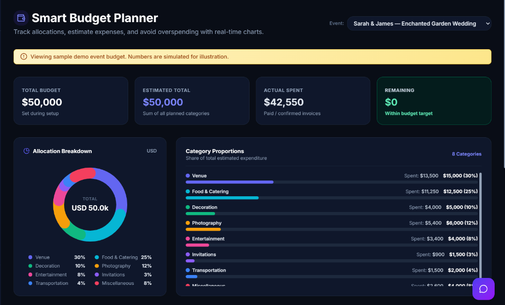
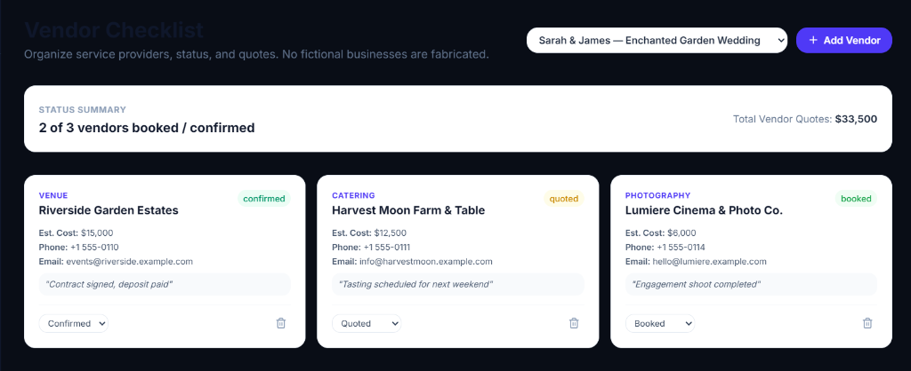
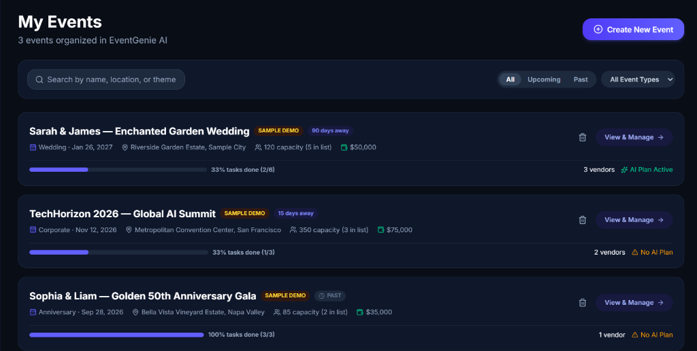
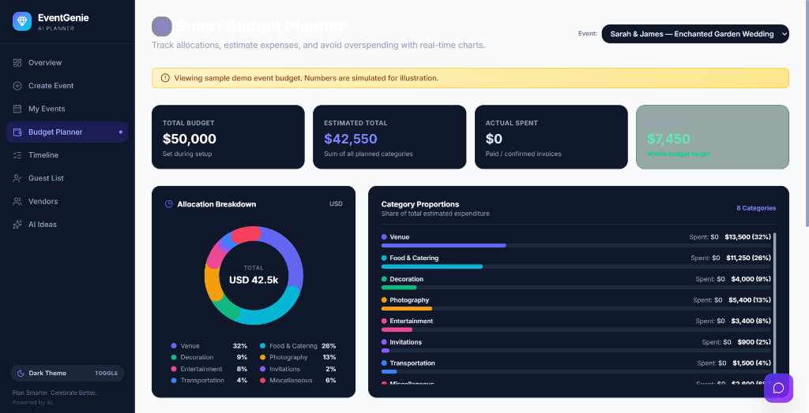
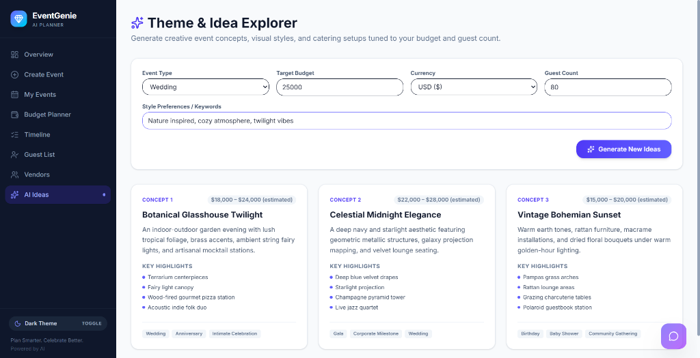

# EventGenie AI

> **"Plan Smarter. Celebrate Better. Powered by AI."**
> 
> *PromptWars Virtual — Challenge 5 Champion Edition*

EventGenie AI is a full-stack, AI-powered event planning web application built for weddings, birthdays, community celebrations, and corporate gatherings. It solves common event planning bottlenecks: budget allocation, preparation timelines, vendor coordination, guest RSVPs, task tracking, and personalized creative ideas.

---

## 🎥 Project Demo Video

A walkthrough demonstration is bundled directly in the repository:
- **MP4 Video File**: [`demo_video.mp4`](./demo_video.mp4) or via public path [`public/demo_video.mp4`](./public/demo_video.mp4)
- *Ready for submission on YouTube / Google Drive or direct playback.*

---

## 📸 Application Screenshots & UI Showcase

### 1. Smart Budget Planner & Interactive SVG Donut Chart


### 2. Vendor Checklist & Quote Management


### 3. Events Portfolio & Status Dashboard


### 4. Guest List & RSVP Dietary Manager


### 5. AI Blueprint Hub & Recommendations


---

## 🚀 Key Features

1. **Event Setup & Validation**: Comprehensive configuration including event type, guest count, budget, currency, venue preference (indoor/outdoor/both), and dietary/special requirements. Complete client-side and server-side validation.
2. **AI Event Plan Generator**: Leverages Google Gemini (`gemini-2.5-flash`) via `@google/genai` to generate structured JSON plans with event concepts, decor concepts, catering suggestions, entertainment ideas, timelines, and personalized recommendations.
3. **Floating AI Chat Genie**: Always-accessible conversational AI assistant in the bottom corner powered by Gemini. Users can ask questions about budget trade-offs, venue choices, themes, guest management, and timeline pacing in natural language.
4. **Guest List & RSVP Manager**: Complete guest roster tracking invitation status (`Invited`, `Confirmed`, `Attending`, `Declined`), companions/plus-ones, dietary restrictions, table assignments, and venue capacity progress bar. Includes one-click CSV export.
5. **Smart Budget Planner & SVG Donut Chart**: 8 standard editable categories (Venue, Food & Catering, Decoration, Photography, Entertainment, Invitations, Transportation, Miscellaneous). Features a pure SVG Donut Chart with color-coded segments, category proportion bars, remaining budget calculations, and real-time over-budget warnings.
6. **Timeline & Task Manager**: Actionable preparation tasks with due dates, priority tiers (`high`, `medium`, `low`), categories, and completion states. Flags past-due and overdue deadlines.
7. **Vendor Checklist**: Track service categories, quotes, booking states (`contacted`, `quoted`, `booked`, `confirmed`, `cancelled`), and contact notes without inventing fictional businesses.
8. **AI Budget Optimizer**: When planned expenses exceed the allocated budget, the AI suggests practical, priority-preserving adjustments showing original vs. proposed allocations and potential savings.
9. **Dark Mode & Modern Design System**: Full light and dark theme switchable with persistent preference in `localStorage`. Tailored indigo/slate palette, glassmorphism, responsive mobile drawer, and sleek micro-animations.
10. **Toast Notification System**: Lightweight, accessible toast notifications with auto-dismissal and success, warning, error, and info variants.
11. **Print & Export Stylesheet**: Formatted print media CSS and `.txt` plan exporter for offline review, meetings, and sharing with vendors.
12. **Curated Demo Experience**: Evaluators can explore a pre-loaded sample event ("Sarah & James — Enchanted Garden Wedding") with complete plan, budget, timeline, guests, and vendors without needing an API key.

---

## 🛠 Tech Stack

- **Framework**: Next.js 16 (App Router, Turbopack, React 19)
- **Language**: TypeScript
- **Styling**: Tailwind CSS v4 with custom design tokens (indigo/cyan visual identity, glassmorphic surfaces, responsive mobile drawer)
- **AI Integration**: `@google/genai` SDK calling Google Gemini (`gemini-2.5-flash`) with structured JSON schema responses and rule-based resilient fallback
- **Storage**: Client-side `localStorage` persistence with zero backend database requirements for instant setup
- **Testing**: Automated unit tests using `tsx` and Node's native test runner (`node:test`, `node:assert`)
- **Icons**: `lucide-react`

---

## 🔒 Security & Privacy

- **Server-Side API Routes**: All Gemini API calls are strictly handled on server routes (`/api/generate-plan`, `/api/optimize-budget`, `/api/explore-ideas`, `/api/chat`).
- **Zero API Key Exposure**: The Gemini API key is never exposed to the client bundle or browser network requests.
- **Strict Input Validation**: Payloads are sanitized and validated both client-side and server-side.
- **No Secrets in Version Control**: `.env.example` provides placeholders only; actual keys are loaded through environment variables.

---

## 📋 Getting Started

### Prerequisites

- Node.js `v20+` or `v24+`
- npm `v10+`

### Installation

1. Navigate to the project directory:
   ```bash
   cd eventgenie-ai
   ```

2. Install dependencies:
   ```bash
   npm install
   ```

3. Configure environment variables:
   ```bash
   cp .env.example .env.local
   ```
   Add your Gemini API key in `.env.local`:
   ```env
   GEMINI_API_KEY=your_actual_gemini_api_key
   ```
   *(Note: The application still runs and can be explored using the pre-loaded Demo Event even without an API key).*

4. Run the development server:
   ```bash
   npm run dev
   ```
   Open [http://localhost:3000](http://localhost:3000) in your browser.

5. Build for production:
   ```bash
   npm run build
   npm run start
   ```

---

## 🧪 Automated Testing

Automated tests cover all critical budget calculations (totals, actuals, remaining, percentages, over-budget detection, AI allocation mapping) and event setup validation rules.

Run the test suite:
```bash
npm test
```

Expected output:
```
✔ Smart Budget Planner Calculations (9 tests)
✔ Event Setup Input Validation (5 tests)
ℹ tests 14
ℹ pass 14
```

---

## 🏆 PromptWars Virtual — Challenge 5 Evaluation Highlights

- **AI Integration Quality**: Deep structured schemas, conversational chat assistant, and contextual budget optimization with zero hallucinated quotes.
- **UI/UX Polish**: Full light/dark mode, interactive SVG donut charts, animated toasts, capacity progress indicators, and responsive layout.
- **Feature Completeness**: Full lifecycle coverage from initial concept to budget breakdown, timeline checklist, vendor coordination, and guest list RSVP management.
